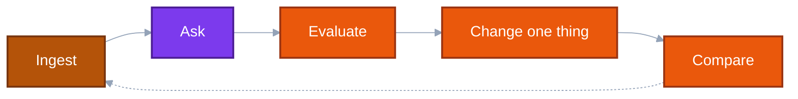
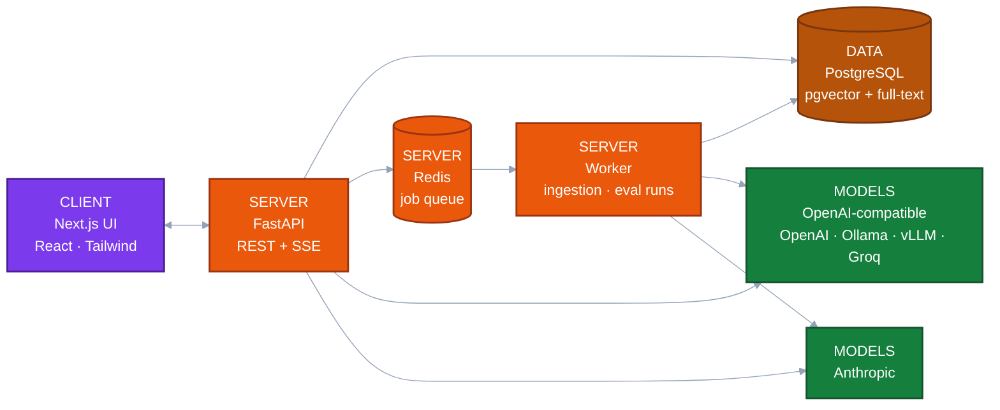

<div align="center">


# Grounded

### Every answer grounded. Every claim measured.

A self-hostable, provider-agnostic **RAG platform with built-in evaluation**.
Ingest documents, get cited answers, then prove the pipeline works with evals and A/B comparisons.

<br />

[](#roadmap)
[](https://nextjs.org)
[](https://fastapi.tiangolo.com)
[](https://github.com/pgvector/pgvector)
[](#quick-start)
[](LICENSE)

[Quick start](#quick-start) · [Features](#features) · [How it works](#how-it-works) · [Providers](#providers) · [Metrics](#evaluation-metrics) · [Roadmap](#roadmap)

</div>

---

## Why Grounded

Teams ship RAG, it gives a wrong answer, and nobody knows whether the cause is chunking, embeddings, retrieval, or the model. They tune by vibes.

Grounded closes that loop. Ingestion, retrieval config, answering, and evaluation live in **one self-hostable tool**, so you can change one variable and see exactly what moved in quality, latency, and cost.



> [!NOTE]
> Tools like Ragas, Langfuse, Phoenix and LangSmith cover parts of this. Grounded keeps the pipeline and its measurement in one place, with a UI built for A/B-testing pipeline configurations.

<!-- Replace with a real screenshot or GIF of the compare view -->

<p align="center">
  
</p>

---

## Features

### Cited answers

- Streamed responses with inline citations (`[1]`, `[2]`) mapped to source document, page and snippet
- Hover a citation to preview the passage, click to open the source with the chunk highlighted
- The model is instructed to say *"not found in the documents"* instead of guessing
- Sources panel separates **cited** chunks from **retrieved but not cited** ones, which helps when debugging

### Retrieval you can tune

- Vector search (pgvector), keyword search (Postgres full-text), and **hybrid** via reciprocal rank fusion
- Configurable `top_k`, retrieval mode and score threshold
- Indexes are **immutable** and tied to a specific chunking and embedding model, so comparisons stay honest

### Built-in evaluation

- Generate a test set from your own documents, or import and edit cases manually
- Retrieval metrics: **Recall@k**, **MRR** (deterministic)
- Generation metrics: **Faithfulness**, **Answer relevance** (LLM-as-judge, with the judge's reasoning kept)
- Latency (p50 / p95) and token cost on every run
- A rule-based diagnostic on each run: did low-faithfulness answers have the right chunk retrieved (a generation problem) or not (a retrieval problem)?

### A/B comparison

- Compare two runs on the same test set: aggregate deltas plus per-question deltas
- Config diff shows only the parameters that changed
- Default sort by largest regression, with an "only changed" filter
- **Copy as Markdown** for pull requests and READMEs
- Warns when two runs used different test sets or judge models

### Any model, your keys

- OpenAI, Anthropic, Ollama, and any OpenAI-compatible endpoint (vLLM, Groq, OpenRouter, LM Studio, Together…)
- Separate model roles for **chat**, **embeddings** and **judge**
- API keys encrypted at rest and never returned to the browser
- Warns when the judge and generator share a model family (self-preference bias)

### A product-grade UI

- Command palette (`⌘K`), keyboard shortcuts, dark and light themes
- Real loading, empty and error states
- A job indicator for running ingestion and eval jobs

---

## Screenshots

| Collections                                                          | Evaluation run                                                     |
| -------------------------------------------------------------------- | ------------------------------------------------------------------ |
| `` | `` |

| Providers and models                                                       | Command palette                                                              |
| -------------------------------------------------------------------------- | ---------------------------------------------------------------------------- |
| `` | `` |

---

## How it works



| Step               | What happens                                                                                                                        |
| ------------------ | ----------------------------------------------------------------------------------------------------------------------------------- |
| **Ingest**   | Upload PDF, DOCX, Markdown or text. Documents are parsed, chunked and embedded in the background, with visible status per document. |
| **Retrieve** | Vector and keyword results are fused with reciprocal rank fusion, then the top-k chunks go to the model.                            |
| **Answer**   | The response streams over SSE with citations mapped back to chunks.                                                                 |
| **Evaluate** | A test set runs through a saved pipeline config. Retrieval is scored deterministically and generation is scored by a judge model.   |
| **Compare**  | Pick two runs and see exactly which parameters changed and which questions improved or regressed.                                   |

### Design decisions

- **One datastore.** Postgres with pgvector handles relational data, vectors and keyword search, so there are fewer moving parts to run.
- **A thin provider layer, not a framework.** Two adapters cover everything: an OpenAI-compatible client and a native Anthropic client, behind one small interface (`chat_stream`, `embed`, `list_models`).
- **Immutable indexes and configs.** Changing chunk size or the embedding model creates a new index. Configs are locked once used in a run.
- **Async jobs.** Ingestion and evals run in a worker and never block the API.

---

## Quick start

**Requirements:** Docker and Docker Compose.

```bash
git clone https://github.com/guriii3108/grounded.git
cd grounded

cp .env.example .env      # add your own secrets
docker compose up -d
```

Open the app, go to **Settings → Providers**, add a provider, and create your first collection.

> [!TIP]
> **Using Ollama?** From inside Docker, `localhost` points at the container, not your machine.
> Use `http://host.docker.internal:11434` as the Ollama base URL, or run Ollama in the same compose network.

### Environment

Provider API keys are added from the UI and stored encrypted, using a key from your environment.

| Variable           | Purpose                                              |
| ------------------ | ---------------------------------------------------- |
| `DATABASE_URL`   | Postgres connection string                           |
| `REDIS_URL`      | Redis connection string                              |
| `ENCRYPTION_KEY` | Fernet key used to encrypt provider API keys at rest |
| `ADMIN_PASSWORD` | Single-admin access to the app                       |

<!-- Keep this table in sync with .env.example -->

---

## Providers

| Provider                             | Chat | Embeddings | Notes                           |
| ------------------------------------ | :--: | :--------: | ------------------------------- |
| OpenAI                               |  ✅  |     ✅     | Native OpenAI-compatible client |
| Anthropic                            |  ✅  |    n/a    | Native adapter                  |
| Ollama                               |  ✅  |     ✅     | Local models, no key needed     |
| vLLM / Groq / OpenRouter / LM Studio |  ✅  |   varies   | Any OpenAI-compatible endpoint  |

Each provider has a **Test connection** button. Models are listed from the provider where supported, with manual entry as a fallback.

---

## Evaluation metrics

| Metric                        | Type             | What it tells you                                                |
| ----------------------------- | ---------------- | ---------------------------------------------------------------- |
| **Recall@k**            | 🟩 Deterministic | Was the ground-truth chunk in the top-k retrieved?               |
| **MRR**                 | 🟩 Deterministic | How high did the right chunk rank?                               |
| **Faithfulness**        | 🟪 LLM-as-judge  | Is every claim in the answer supported by the retrieved context? |
| **Answer relevance**    | 🟪 LLM-as-judge  | Does the answer actually address the question?                   |
| **Latency (p50 / p95)** | 🟨 Measured      | How fast is the full pipeline?                                   |
| **Cost**                | 🟨 Measured      | Token spend per run                                              |

> [!WARNING]
> **Judge scores are judge-relative.** LLM-as-judge is noisy. Grounded runs the judge at temperature 0 with a fixed rubric and keeps its reasoning visible. Use scores to compare configurations against each other, not as absolute truth, and prefer a judge that is not the generator model.

### Benchmarks

<!-- Fill this in after running on a public QA dataset. Do not publish numbers you haven't measured. -->

| Config          | Recall@5 | Faithfulness | p95 latency | Cost |
| --------------- | -------- | ------------ | ----------- | ---- |
| _to be added_ | –       | –           | –          | –   |

---

## Tech stack

| Layer      | Choice                                         |
| ---------- | ---------------------------------------------- |
| Frontend   | Next.js (App Router), TypeScript, Tailwind CSS |
| Backend    | FastAPI, Pydantic                              |
| Jobs       | Redis + background worker                      |
| Database   | PostgreSQL with pgvector and full-text search  |
| Deployment | Docker Compose                                 |

---

## Meet the crew

<table>
  <tr>
    <td align="center" width="33%">
      <br />
      <strong>Mochi</strong><br />
      <sub>Ingestion and collections</sub>
    </td>
    <td align="center" width="33%">
      <br />
      <strong>Wisp</strong><br />
      <sub>Chat and retrieval</sub>
    </td>
    <td align="center" width="33%">
      <br />
      <strong>Nova</strong><br />
      <sub>Evaluation and judging</sub>
    </td>
  </tr>
</table>

---

## Roadmap

**MVP (current)**

- [X] Multi-format ingestion with async status
- [X] Hybrid retrieval with citations
- [X] Provider and model configuration
- [X] Eval harness, run detail and A/B compare

**Next**

- [ ] Reranker as another A/B variable
- [ ] Recursive and semantic chunking, parent-document retrieval
- [ ] Query rewriting / HyDE toggles
- [ ] Cost-vs-quality chart
- [ ] CI eval gate: a GitHub Action that fails a PR if recall or faithfulness regresses
- [ ] Per-query tracing view (retrieval → prompt → response, with timings)
- [ ] Multi-user auth and workspaces
- [ ] Alternative vector backends behind an interface

---

## Limitations

- Single-admin auth only. There is no multi-tenant isolation yet.
- Single-node deployment, with no horizontal scaling.
- Text-based documents only. No image, audio or OCR ingestion yet.
- Changing chunking or the embedding model requires re-indexing.
- Judge-based metrics are judge-relative (see above).

---

## Contributing

Issues and pull requests are welcome. For larger changes, open an issue first so we can discuss the approach.

```bash
# run checks before opening a PR
# backend:  ruff, mypy, pytest
# frontend: lint, type-check, build
```

---

## License

MIT. See [LICENSE](LICENSE).

<div align="center">
<sub>Built by <a href="https://github.com/guriii3108">Gurveer Singh</a> · Every answer grounded.</sub>
</div>
